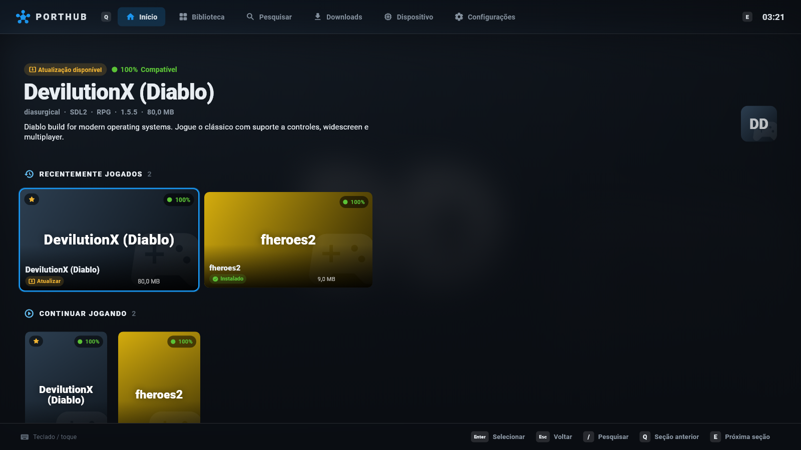
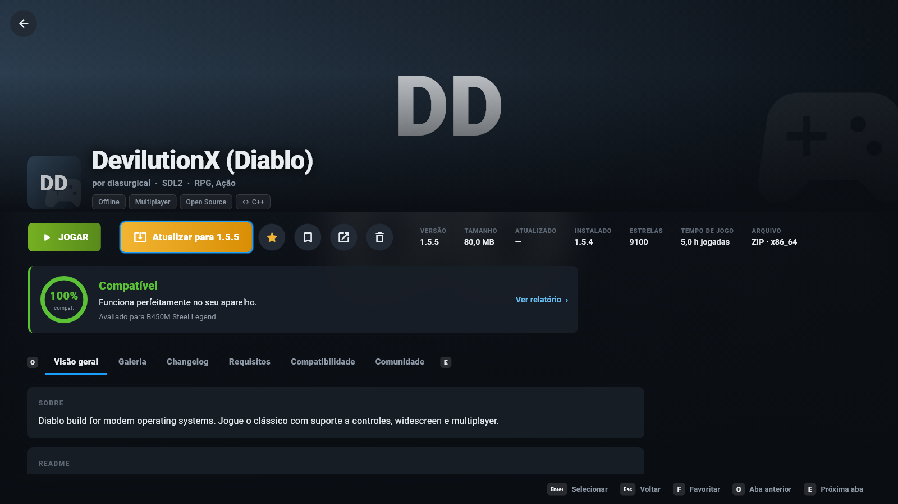
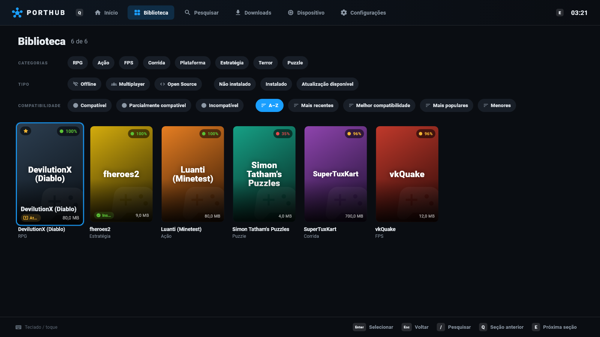
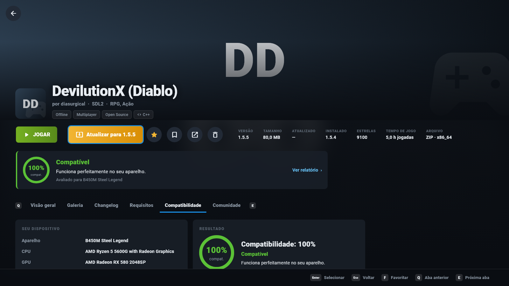

# PortHub

Launcher em tela cheia, inspirado na **Steam Big Picture**, para **ports e jogos open source distribuídos pelo GitHub**.
Navegue com controle (Xbox, DualSense, DualShock, Bluetooth genérico), toque, teclado ou mouse; o PortHub busca
releases automaticamente, detecta o arquivo certo para o seu aparelho, baixa, verifica, instala e abre o jogo, e
avisa **antes** de instalar se o jogo vai rodar bem no seu hardware.

- **Plataformas:** Android, Windows e Linux (Flutter, Material Design 3, tema escuro)
- **Licença:** MIT — 100% open source

| Início | Página do jogo |
|---|---|
|  |  |
| **Biblioteca** | **Relatório de compatibilidade** |
|  |  |

<sub>Capturas geradas por `test/screenshot_test.dart` com dados de exemplo (sem rede, por isso as capas são as
geradas pelo app; com conexão aparecem as imagens dos repositórios).</sub>

---

## Sumário

1. [Recursos](#recursos)
2. [Como rodar](#como-rodar)
3. [Estrutura de pastas](#estrutura-de-pastas)
4. [Arquitetura](#arquitetura)
5. [Motor de compatibilidade](#motor-de-compatibilidade)
   · [Atualização automática](#atualização-automática)
6. [Integração com o GitHub](#integração-com-o-github)
7. [Provedores de jogos](#provedores-de-jogos)
8. [Capas e capturas de tela](#capas-e-capturas-de-tela)
9. [Emuladores (Xbox 360 / XenDroid)](#emuladores-xbox-360--xendroid)
10. [Banco de dados](#banco-de-dados)
11. [Download Manager e instalação](#download-manager-e-instalação)
12. [Navegação por controle](#navegação-por-controle)
13. [PortHub Compatibility Database](#porthub-compatibility-database)
14. [Backend opcional](#backend-opcional)
15. [Para porters: `porthub.yaml`](#para-porters-porthubyaml)
16. [Testes](#testes)
17. [Limitações conhecidas](#limitações-conhecidas)

---

## Recursos

| Área | O que faz |
|---|---|
| **Interface Big Picture** | Fundo desfocado com o banner do jogo em foco, destaque grande, prateleiras horizontais, cards que crescem com brilho azul ao receber foco, transições suaves, barra de dicas do controle e relógio. |
| **Tela inicial** | Recentemente jogados · Continuar jogando · Recomendados · Compatíveis com meu aparelho · Parcialmente compatíveis · Incompatíveis · Atualizações disponíveis · Favoritos · Lista de desejos · Biblioteca completa. |
| **Biblioteca** | Grade com capa, nome, compatibilidade (verde/amarelo/vermelho + %), tamanho e status (Instalado / Atualização disponível / Não instalado). Filtros por categoria (RPG, Ação, FPS, Corrida, Plataforma, Estratégia, Terror, Puzzle), Offline / Multiplayer / Open Source, status, compatibilidade e ordenação. |
| **Página do jogo** | Banner, ícone, desenvolvedor, engine, categoria, versão, tamanho, última atualização; botões **Instalar / Atualizar / Jogar**, Favorito, Lista de desejos, Abrir GitHub, Desinstalar; abas **Visão geral** (descrição, resumo, README, issues fixadas), **Galeria**, **Changelog**, **Requisitos**, **Compatibilidade** e **Comunidade**. |
| **Pesquisa** | Estilo Steam, ao vivo, por nome, desenvolvedor, categoria, engine ou tag. |
| **GitHub** | Releases, assets, README, descrição, tópicos, linguagem, licença, estrelas e issues fixadas (com token). Cache local com ETag. |
| **Hardware** | Análise completa na primeira execução (Android, Linux e Windows) e relatório em *Dispositivo*. |
| **Compatibilidade** | Motor dedicado: requisitos × hardware → verificações → score 0–100 → nível e motivo exato. |
| **Downloads** | Pausar, continuar (HTTP Range), cancelar, progresso, velocidade, ETA, downloads simultâneos, SHA256/MD5, segundo plano no Android. |
| **Instalação** | Android: APK, APK dividido (`.apks/.xapk/.apkm`), ZIP. Linux: AppImage, executável, ZIP/TAR. Windows: EXE, MSI, ZIP. Tipo detectado automaticamente. |
| **Atualizações** | Compara a versão instalada com a última release; notificação + botão Atualizar. |
| **Emuladores** | Aba própria por console. **Xbox 360 → XenDroid**: instala/atualiza o emulador, importa ISOs (arquivo ou pasta, sem copiar), lê o Title ID do disco, busca nome e capa no **XboxUnity** (como o Aurora, com seletor de capas) e abre o jogo direto no emulador. |
| **Capas automáticas** | Ports sem imagem ganham a boxart e capturas de tela do jogo original (acervo libretro, Steam, Wikipédia). |
| **Extras** | Importação de jogos já instalados, modo offline, múltiplos provedores, atualização automática da biblioteca, sistema de logs, configurações avançadas, resumo por IA local opcional (Ollama). |

---

## Como rodar

Pré-requisitos: [Flutter](https://docs.flutter.dev/get-started/install) **3.38+** (testado com 3.47.7 / Dart 3.13).

```bash
flutter pub get
flutter run -d windows      # requer Visual Studio com "Desktop development with C++"
flutter run -d linux        # requer clang, cmake, ninja, pkg-config, libgtk-3-dev
flutter run -d <android>    # celular, TV box ou handheld Android
```

Builds de distribuição:

```bash
flutter build apk --release --split-per-abi
flutter build windows --release
flutter build linux --release
```

Dicas:

- **Token do GitHub (recomendado):** *Configurações → GitHub → Token pessoal*. Um token sem nenhum escopo já basta.
  Sem token a API permite 60 requisições/hora; com token, 5000 e as issues fixadas passam a aparecer.
- **Linux:** para detecção completa de GPU/OpenGL/Vulkan instale `mesa-utils` (`glxinfo`) e `vulkan-tools` (`vulkaninfo`).
  O app também lê `/proc`, `/sys` e `lspci` quando eles não existem.
- **Android:** na primeira instalação o sistema pede permissão para "instalar apps desconhecidos".

> **Nota sobre esta pasta:** o diretório foi criado inicialmente pelo Android Studio como projeto Android nativo.
> Os arquivos `app/`, `gradle/`, `build.gradle.kts`, `settings.gradle.kts`, `gradlew*` e `gradle.properties` **na
> raiz** são desse template e não são usados pelo Flutter (o Android do Flutter fica em `android/`). Podem ser apagados.

---

## Atualização automática

O workflow [`.github/workflows/android-release.yml`](.github/workflows/android-release.yml) roda a cada push na `main`:
análise estática → testes → APK de release **assinado sempre com a mesma chave** → release `v1.0.<run>` com o APK.

No celular, o PortHub confere essa release ao abrir, ao voltar do segundo plano (após 1 h) e a cada 6 horas. Quando
há build novo, aparece um aviso na barra superior e uma notificação; em **Configurações › Atualizações do PortHub**,
**Atualizar** baixa o APK, confere o SHA256 e abre o instalador do Android por cima da versão atual (os dados ficam).

- O repositório e o número do build entram no APK pelo próprio workflow (`--dart-define=PORTHUB_UPDATE_REPO` e
  `PORTHUB_BUILD`); builds locais mostram "build local" e não se atualizam.
- **Repositório privado:** crie um token *fine-grained* em GitHub › Settings › Developer settings com acesso só a este
  repositório e permissão **Contents: Read-only**, e cole em **Configurações › Token pessoal do GitHub** no celular. O
  mesmo token aumenta a cota da API (5.000/h) para o catálogo.
- **Chave de assinatura:** fica fora do repositório (`android/key.properties` local + secrets `PORTHUB_KEYSTORE_*` no
  GitHub). Guarde um backup do `.jks`: sem ele, uma nova chave obriga a desinstalar o app para atualizar.
- A primeira instalação a partir das releases precisa substituir builds de debug (assinatura diferente): desinstale
  a versão de teste antes.

---

## Estrutura de pastas

```
lib/
 ├── main.dart                 # injeção de dependências, janela/tela cheia, captura de erros
 ├── app.dart                  # MaterialApp, tema, roteamento de teclas
 ├── core/                     # modelos, logger, formatação, versões, plataforma
 │   └── models/               # Game, GameRequirements, ReleaseInfo, HardwareProfile, ...
 ├── database/                 # SQLite: schema + DAOs (jogos, downloads, hardware, cache, settings)
 ├── github/                   # cliente REST/GraphQL, detector de assets, README e porthub.yaml
 ├── compatibility/            # motor de compatibilidade + tabela de desempenho de CPU/GPU
 ├── downloads/                # Download Manager e verificação de integridade
 ├── emulators/                # aba Emuladores: consoles, biblioteca de ROMs, leitor de ISO e XboxUnity
 ├── services/                 # biblioteca, instalação, ações, capas, hardware, provedores, comunidade, IA, gamepad
 │   ├── hardware/             # sondas Android / Linux / Windows
 │   └── providers/            # adaptadores: GitHub, PortMaster, Open Source, lista JSON
 ├── ui/                       # tema, shell Big Picture, roteador de entrada (controle/teclado)
 ├── widgets/                  # Focusable, GameCard, GameShelf, GameArt, badges, botões, HintBar
 └── pages/                    # Início, Biblioteca, Emuladores, Pesquisa, Jogo (abas), Downloads, Dispositivo, Configurações, Logs
android/app/src/main/kotlin/   # MainActivity (hardware, PackageInstaller, gamepads), RomFiles (ISOs via SAF), DownloadService
assets/catalog/community.json  # catálogo comunitário embarcado
backend/server.js              # backend opcional (proxy de cache + Compatibility Database)
test/                          # testes do motor, parsing do GitHub e sonda de hardware
```

---

## Arquitetura

```
           ┌──────────── UI (pages / widgets / ui) ─────────────┐
           │  Provider (ChangeNotifier) · InputRouter · Focus   │
           └───────────────┬────────────────────────────────────┘
                           │
 ┌─────────────┬───────────┼─────────────┬───────────────┬──────────────┐
 │LibraryService│ GameActions│DownloadManager│HardwareService│CommunityService│
 └──────┬──────┘ └────┬─────┘ └──────┬──────┘ └──────┬──────┘ └──────┬───────┘
        │             │              │               │               │
 Providers ──► GitHubClient ──► http_cache   InstallService   Probes (Android/Linux/Windows)
 (GitHub, PortMaster,  │                     (APK/ZIP/AppImage/EXE)
  Open Source, JSON)   ▼
                 CompatibilityEngine ◄── HardwareProfile
                           │
                        SQLite (jogos, downloads, hardware_cache, http_cache, settings)
```

- **Camadas:** `core` não depende de nada; `github`, `compatibility`, `database` dependem só de `core`; `services`
  orquestram; `ui/pages/widgets` só falam com serviços via `provider`.
- **Estado:** `ChangeNotifier` + `provider` (simples e estável). Sem geração de código.
- **Injeção de dependências:** manual em `main.dart` — fácil de ler e de testar.
- **Fluxo "Instalar":** `GameActions.install` → escolhe o melhor asset (`AssetDetector.pickBest`) → resolve checksum →
  `DownloadManager.enqueue` → ao concluir e verificar → `InstallService.install` → `LibraryService.markInstalled`.

---

## Motor de compatibilidade

`lib/compatibility/compatibility_engine.dart`

**Fluxo:** 1) detectar hardware → 2) obter requisitos (porthub.yaml > catálogo > README) → 3) comparar → 4) gerar
score → 5) exibir relatório.

| Componente | Peso | Como é avaliado |
|---|---:|---|
| CPU | 20 | Tier 0–100 do chip (`hardware_tiers.dart`) × nível exigido (`cpu: low/mid/high`) |
| GPU | 20 | Tier 0–100 da GPU × nível exigido (`gpu: ...`) |
| RAM | 25 | Mínima / recomendada (com tolerância de ~10% — o sistema reporta menos que o valor comercial) |
| API gráfica | 15 | Vulkan obrigatório, OpenGL ES (Android), OpenGL (desktop), DirectX (Windows) |
| Arquitetura | 20 | ABI exigida ou oferecida pelos assets × ABIs do aparelho (ARM64 rodando build ARMv7 = parcial) |

Também verifica **plataforma**, **versão do Android** e **armazenamento livre**.

- **Verde — Compatível:** "Funciona perfeitamente no seu aparelho." (sem alertas e score ≥ 75)
- **Amarelo — Parcialmente compatível:** "Pode apresentar queda de desempenho." (há alertas ou score < 75)
- **Vermelho — Incompatível:** mostra o motivo exato, ex.: *"Requer ARM64 e seu aparelho é ARMv7."* (score limitado a 35)

Exemplo real do relatório (aba *Compatibilidade*):

```
Seu dispositivo                         Resultado
CPU:  Qualcomm SM7325                   Compatibilidade: 96%
GPU:  Adreno (TM) 642L                  ✔ RAM suficiente (7,4 GB / mín. 4 GB)
RAM:  7,4 GB                            ✔ Vulkan suportado (1.1)
Arquitetura: ARM64                      ✔ ARM64 compatível
Android: 13                             ✔ Android 13 acima do mínimo (10)
```

Quando o repositório não declara requisitos, a avaliação é marcada como **estimada** (usa arquitetura dos assets,
API gráfica e desempenho de CPU/GPU).

---

## Integração com o GitHub

`lib/github/`

- **REST:** `/repos/{o}/{r}`, `/releases`, `/readme`, `/contents/porthub.yaml`, `/search/repositories`.
- **GraphQL:** issues fixadas (a REST não expõe "pinned issues"; requer token).
- **Cache** (`http_cache`): resposta fresca (TTL 6 h / README 24 h) → sem rede; vencida → requisição condicional com
  `If-None-Match` (respostas 304 **não** contam no rate limit); offline/rate limit → usa o cache vencido. 404 também
  é cacheado.
- **Economia de rate limit:** sem token e com poucas requisições restantes, o README é adiado e carregado ao abrir o jogo.
  A sincronização começa pelos jogos instalados e pelos emuladores; com a cota esgotada, o app para de chamar a API
  até o horário de reset.
- **Plano B sem cota:** quando a API anônima (60/h) acaba, a última release é lida pelas páginas públicas
  `github.com/{o}/{r}/releases/latest` e `/releases/expanded_assets/{tag}` (arquivos, SHA256, tamanho e data), que não
  consomem a cota. O changelog fica para quando houver cota.
- **Detecção de assets** (`asset_detector.dart`): tipo (APK, APK dividido, ZIP, TAR, AppImage, EXE, MSI, DEB,
  checksum), plataforma e arquitetura pelo nome — testado com nomes reais (Luanti, DevilutionX, fheroes2, OpenRA,
  Cataclysm-DDA, SuperTux…). Ignora código-fonte, símbolos de debug e `.sig/.asc`.
- **Extração do README:** descrição curta, galeria (sem badges/SVG, URLs relativas resolvidas), engine, categorias,
  tags (Offline/Multiplayer/Open Source) e requisitos por heurística (*"Requires Android 8.0 or higher"*, *"3 GB of
  RAM"*, *"Vulkan is required"*, *"OpenGL ES 3.0"*).
- **Imagens:** capa = imagem do `porthub.yaml`/catálogo/README ou a arte do jogo original (ver
  [Capas e capturas de tela](#capas-e-capturas-de-tela)); ícone = avatar do dono. Sem imagem, o app gera uma capa com
  gradiente. Tudo fica em cache em disco.
- **Repositórios-isca:** a descoberta por tópicos descarta repositórios do tipo "jogo X completo, download grátis",
  "crack", "mod apk" etc., comuns em buscas por jogos famosos e que costumam distribuir malware.

---

## Provedores de jogos

Cada fonte implementa `GameSourceProvider` (`lib/services/providers/`) e pode ser ligada/desligada nas Configurações.

| Provedor | Padrão | Fonte |
|---|---|---|
| **Lista JSON comunitária** | ligado | `assets/catalog/community.json` ou URL própria (fork/espelho) |
| **GitHub (tópicos)** | ligado | repositórios com os tópicos `porthub`, `android-port` ou `game-port` |
| **PortMaster** | ligado só no Linux | `ports.json` das releases de `PortsMaster/PortMaster-New` (ports aarch64; MD5 verificado) |
| **Repositórios Open Source** | desligado | tópico `open-source-game` com mais de 300 estrelas |

Formato da lista JSON:

```json
{
  "games": [
    {
      "repo": "diasurgical/devilutionX",
      "name": "DevilutionX (Diablo)",
      "categories": ["RPG", "Ação"],
      "engine": "SDL2",
      "tags": ["Offline", "Multiplayer", "Open Source", "Requer arquivos do jogo"],
      "android_package": "org.diasurgical.devilutionx",
      "prereleases": false,
      "original": { "title": "Diablo", "wikipedia": "Diablo (video game)", "systems": ["Sony - PlayStation"] },
      "game_data": "Copie DIABDAT.MPQ do seu CD/GOG para a pasta indicada pelo app.",
      "requirements": { "ram": "1GB", "android": "6+", "gles": "2.0", "cpu": "low", "gpu": "low" }
    }
  ]
}
```

- `original`: o jogo de que o port deriva — usado para buscar capa e capturas quando o repositório não tem imagens.
  `systems` são pastas do acervo libretro (`Microsoft - Xbox`, `Sony - PlayStation 2`, `Nintendo - Wii`…).
- `game_data`: aviso exibido na página do jogo quando o port exige os arquivos do jogo original.
- `"categories": ["Emulador"]` faz a entrada aparecer na aba Emuladores, e não entre os jogos.

Os requisitos do catálogo embarcado são **estimativas da comunidade**; o `porthub.yaml` do próprio repositório
sempre tem prioridade.

---

## Capas e capturas de tela

`lib/services/artwork_service.dart`. A maioria dos ports de recompilação não tem imagens no README, então o PortHub
busca a arte do **jogo original**, só em fontes públicas sem chave de API:

1. **Acervo de miniaturas do libretro** (`thumbnails.libretro.com`, o mesmo do RetroArch): boxart → capa,
   captura de tela → banner e galeria, tela de título → galeria. O índice de cada console é baixado uma vez por
   semana (dezenas de KB com gzip).
2. **Steam**, apenas com o `steam_appid` informado no catálogo (a busca por nome confunde remakes, ex.: Most Wanted
   2005 × 2012).
3. **Wikipédia**: imagem do artigo (normalmente a capa).

Só aceita o resultado quando o nome normalizado bate exatamente com o procurado (`"Need for Speed - Underground 2
(USA)"` = `"Need for Speed™: Underground 2"`), preferindo USA → World → Europa e descartando betas e demos — melhor
ficar sem capa do que mostrar a de outro jogo. Para ports descobertos pelos tópicos, o nome vem do repositório
(`Black-Android` → `Black`). Resultados ficam em cache por 14 dias.

---

## Emuladores (Xbox 360 / XenDroid)

`lib/emulators/`. Aba **Emuladores**, um painel por console:

- **Emulador:** o [XenDroid](https://github.com/rfandango/XenDroid) (Xenia Edge para Android, Vulkan) é uma entrada
  do catálogo com a categoria `Emulador`, então usa o mesmo download, verificação SHA256, instalação, atualização e
  motor de compatibilidade dos ports (requisitos: Android 10+, arm64, Vulkan, Snapdragon 8 Gen 2 / Adreno 740 ou
  superior).
- **Importar ISO / pasta:** seletor do sistema (Storage Access Framework). Nada é copiado: o PortHub guarda o
  `content://` com permissão persistente e lê só os setores necessários (`RomFiles.kt`).
- **Identificação** (`xiso_reader.dart`): lê o sistema de arquivos XDVDFS — inclusive em cópias completas XGD1/XGD2/XGD3,
  onde a partição de jogo começa em 0x18300000/0xFD90000/0x2080000 —, acha o `default.xex` e tira do cabeçalho XEX2 o
  **Title ID**, o Media ID e o número do disco.
- **Capas estilo Aurora** (`xbox_unity.dart`): o Title ID vai para a API pública do **XboxUnity** (a mesma base do
  dashboard Aurora em consoles RGH/JTAG) → nome oficial + todas as capas da comunidade, oficiais primeiro. A capa
  vem aberta (verso, lombada e frente) e o cartão mostra só a frente. **Opções (X) → Trocar capa** abre o seletor com
  todas elas; a boxart do marketplace do Xbox 360 fica como alternativa (é servida só por HTTP, liberado apenas para
  esse domínio em `network_security_config.xml`).
- **Jogar:** abre o jogo direto na `EmulatorHostActivity` do XenDroid com a URI como `data` e permissão de leitura
  temporária; o XenDroid resolve o caminho real ou lê pelo descritor (`/proc/self/fd`), sem precisar de acesso a
  todos os arquivos.
- ISOs comprimidos (`.zar`) não têm o XEX legível; são identificados pelo nome do arquivo.

---

## Banco de dados

SQLite (`porthub.db` no diretório de suporte do app). `sqflite` no Android e `sqflite_common_ffi` no desktop.
Versão 2 do esquema: coluna `extras` (jogo original, aviso de arquivos do jogo, origem da capa) em `jogos` e a tabela
`roms` (jogos importados para emuladores: URI, Title ID, Media ID, disco, capa escolhida, última vez jogado).

| Tabela | Conteúdo |
|---|---|
| `jogos` | `id, nome, descricao, autor, github_url, versao, tamanho, categoria, engine, capa, banner, instalado, caminho, compatibilidade` + README, releases (JSON), requisitos (JSON), relatório de compatibilidade (JSON), favoritos, lista de desejos, tempo de jogo, versão instalada… |
| `hardware_cache` | histórico das análises de hardware (JSON), mantém as 10 últimas |
| `downloads` | fila e histórico do Download Manager (bytes recebidos, estado, checksum, erro) |
| `http_cache` | respostas do GitHub/catálogo/comunidade com ETag |
| `settings` | configurações chave/valor |

---

## Download Manager e instalação

`lib/downloads/download_manager.dart` · `lib/services/install_service.dart`

- Fila com **N downloads simultâneos** (1–6). **Pausar/continuar** com `Range` sobre o arquivo `.part` — também
  depois de fechar o app. **Velocidade** (janela móvel de 3 s) e **ETA**.
- **Integridade:** SHA256 do campo `digest` da API de releases, de arquivos `SHA256SUMS`/`checksums.txt`/`*.sha256`
  da mesma release, ou MD5 (PortMaster). O hash é calculado em um *isolate*.
- **Segundo plano (Android):** `DownloadService` (foreground service `dataSync`) mantém o processo vivo e mostra o progresso.
- **Instalação:**
  - Android → `PackageInstaller` (uma sessão com vários APKs = APK dividido; em ZIP, escolhe o APK da ABI certa);
  - Linux → AppImage/executável recebem `chmod +x`; ZIP/TAR são extraídos e o executável é localizado (ELF, `.sh`,
    `.x86_64`, `.AppImage`); `.deb` é aberto no instalador do sistema;
  - Windows → ZIP portátil (localiza o `.exe` principal, ignorando `unins*`, `vc_redist`…), EXE portátil copiado,
    instaladores EXE/MSI executados.
- **Jogar:** Android abre o pacote; no desktop o processo é iniciado e o **tempo de jogo** é contado até ele terminar.
- **Importar jogos instalados:** Android compara os apps instalados com `android_package`/nome; desktop lê os
  marcadores `.porthub.json` da pasta de jogos.

---

## Navegação por controle

Controles via plugin [`gamepads`](https://pub.dev/packages/gamepads) (eventos normalizados no layout Xbox) — Xbox,
DualSense, DualShock e Bluetooth genérico. Os glifos da barra inferior mudam para ✕ ○ □ △ com controles PlayStation.

| Controle | Teclado | Ação |
|---|---|---|
| D-pad / analógico esquerdo | setas | mover o foco (com repetição ao segurar) |
| **A** / ✕ | Enter / Espaço | confirmar |
| **B** / ○ | Esc | voltar |
| **LB / RB** | Q / E | seção (aba) anterior / próxima |
| **LT / RT** | PgUp / PgDn | rolagem rápida (pula 5 itens) |
| **X** / □ | F | favoritar (na página do jogo) |
| **Y** / △ | `/` ou F3 | pesquisar |
| Start / Options | F1 | configurações |
| — | F11 | alternar tela cheia (desktop) |

Mouse e toque funcionam em todos os elementos (listas horizontais podem ser arrastadas com o mouse).

---

## PortHub Compatibility Database

Inspirado no ProtonDB: além dos requisitos declarados, o app mostra **relatos reais** de quem testou o port.

| Item | Exemplo |
|---|---|
| Compatibilidade oficial | 92% |
| Relatos da comunidade | Ouro |
| FPS médio | 58 FPS |
| Testado em | SM7325 |
| Problemas conhecidos | Áudio baixo |

Quando há relatos de aparelhos com hardware semelhante (mesmo SoC/GPU ou desempenho de CPU **e** GPU a até 12
pontos na tabela de tiers), o app diz: *"Este jogo foi testado por 37 usuários com hardware semelhante ao seu. A
maioria relatou desempenho excelente."* Classificações: Platina, Ouro, Prata, Bronze, Quebrado. O usuário pode enviar
o próprio relato (aparelho, SoC, GPU e RAM são preenchidos automaticamente).

A base é servida pelo backend opcional (abaixo). Configure a URL em *Configurações → Comunidade*.

---

## Backend opcional

`backend/server.js` — Node.js 18+, **sem dependências**.

```bash
cd backend
GITHUB_TOKEN=ghp_xxx PORT=8787 node server.js
```

| Rota | Função |
|---|---|
| `GET /gh/<caminho da API>` | proxy de cache da GitHub API (memória + disco, ETag, TTL `CACHE_TTL_SECONDS`, padrão 600) |
| `GET /api/reports?game=<id>` | relatos de um jogo |
| `POST /api/reports` | envia um relato (validado; limite de 10/h por IP) |
| `GET /api/summary?game=<id>` | agregado (classificação dominante, contagens, FPS médio) |
| `GET /api/health` | status |

No app: *Configurações → GitHub → Backend de cache* = `http://<ip>:8787` e *Comunidade* = `http://<ip>:8787`.
Um único servidor com token atende todos os aparelhos da casa (TV box, celular, PC) sem estourar o rate limit.

---

## Para porters: `porthub.yaml`

Adicione o tópico **`porthub`** ao repositório para aparecer no provedor GitHub, e um `porthub.yaml` na raiz para
declarar requisitos oficiais (prioridade máxima no motor de compatibilidade):

```yaml
name: Meu Port
category: [RPG, Ação]          # RPG, Ação, FPS, Corrida, Plataforma, Estratégia, Terror, Puzzle
engine: SDL2
tags: [Offline, Multiplayer]
android_package: org.exemplo.meuport
cover: https://raw.githubusercontent.com/eu/meuport/main/art/capa.png     # 2:3
banner: https://raw.githubusercontent.com/eu/meuport/main/art/banner.jpg  # 16:9
requirements:
  ram: 4GB
  recommended_ram: 6GB
  architecture: arm64-v8a      # ou lista: [arm64-v8a, armeabi-v7a, x86_64]
  platforms: [android, linux]
  android: 10+
  vulkan: true                 # true = obrigatório
  gles: 3.2                    # OpenGL ES mínimo (Android)
  opengl: 3.3                  # OpenGL mínimo (desktop)
  directx: 11                  # Windows
  storage: 2GB
  cpu: mid                     # low | mid | high | ultra | 0–100
  gpu: high
```

Nomeie os assets com plataforma e arquitetura (ex.: `meuport-1.2-android-arm64-v8a.apk`,
`meuport-1.2-linux-x86_64.AppImage`, `meuport-1.2-windows-x64.zip`) e publique um `SHA256SUMS` (ou deixe o GitHub
gerar o `digest`) para verificação de integridade. Um exemplo completo está em [`docs/porthub.example.yaml`](docs/porthub.example.yaml).

---

## Testes

```bash
flutter test                         # compatibilidade, assets, README, ISO de Xbox 360, capas, filtro de iscas, catálogo
flutter test test/hardware_probe_test.dart   # análise real do hardware da máquina (Windows/Linux)
PORTHUB_LIVE=1 flutter test test/live        # GitHub (~4 requisições), libretro, Wikipédia e XboxUnity reais
PORTHUB_LIVE=1 flutter test test/web_release_test.dart   # releases pela página pública (sem cota da API)
```

---

## Limitações conhecidas

- **Pinned issues** só aparecem com token (exigem GraphQL).
- **Instaladores externos** (EXE/MSI/DEB) não são rastreados: o jogo é marcado como instalado, mas o botão Jogar não
  sabe qual executável abrir — use o menu do sistema.
- **Tempo de jogo no Android** é medido pelo intervalo até o PortHub voltar ao primeiro plano.
- **Tabela de tiers de CPU/GPU** é heurística; chips desconhecidos são estimados pelo número de núcleos (marcado
  como "estimado" no relatório). Contribuições são bem-vindas em `lib/compatibility/hardware_tiers.dart`.
- **PortMaster** depende de runtimes do próprio PortMaster em handhelds Linux aarch64; no PC x86_64 os ports
  aparecem como incompatíveis (motivo: arquitetura).
- **XenDroid** exige ARM64 com Vulkan (Snapdragon 8 Gen 2 / Adreno 740 recomendados); em emuladores x86_64 do
  Android Studio ele instala, mas fecha ao abrir (bibliotecas nativas só ARM64). A entrega do ISO pelo PortHub foi
  testada até a `EmulatorHostActivity`.
- **Capas do XboxUnity** dependem do serviço da comunidade estar no ar; sem ele, fica a boxart do marketplace ou a
  capa gerada.
- **Sem token**, a primeira sincronização usa o plano B (páginas públicas) para a maior parte do catálogo: versões,
  arquivos e SHA256 vêm completos, mas changelog e README só chegam quando houver cota.
- **Android 15+** limita serviços `dataSync`; downloads muito longos em segundo plano podem pausar e retomar ao
  voltar para o app.

---

## Licença

[MIT](LICENSE). Os jogos listados pertencem aos seus respectivos autores e licenças; o PortHub apenas baixa os
arquivos publicados por eles no GitHub.
